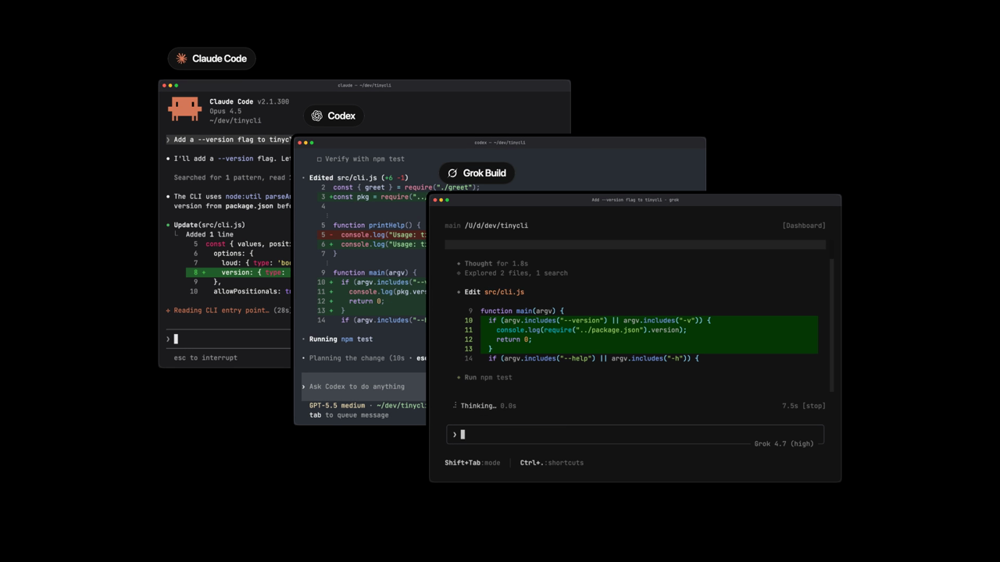
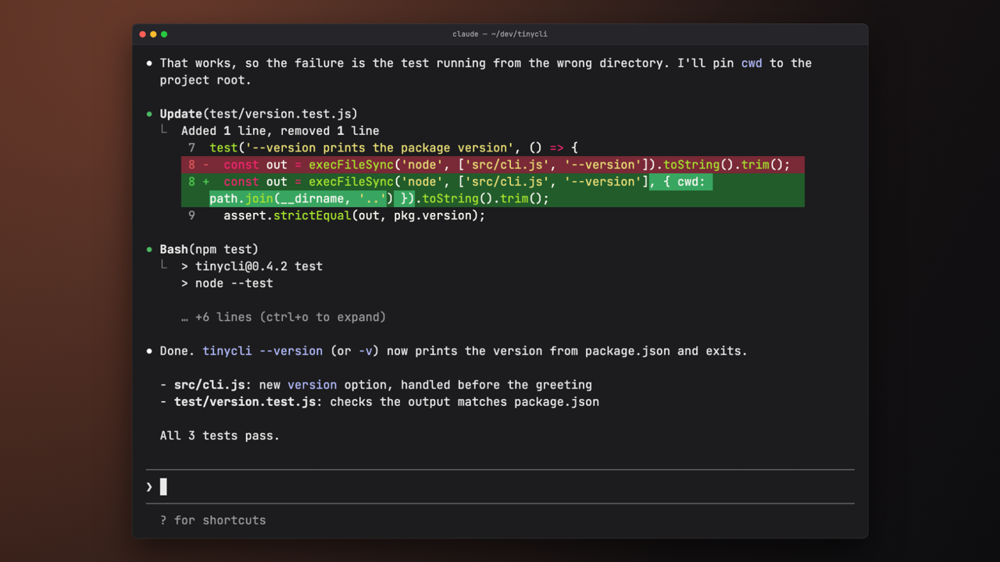
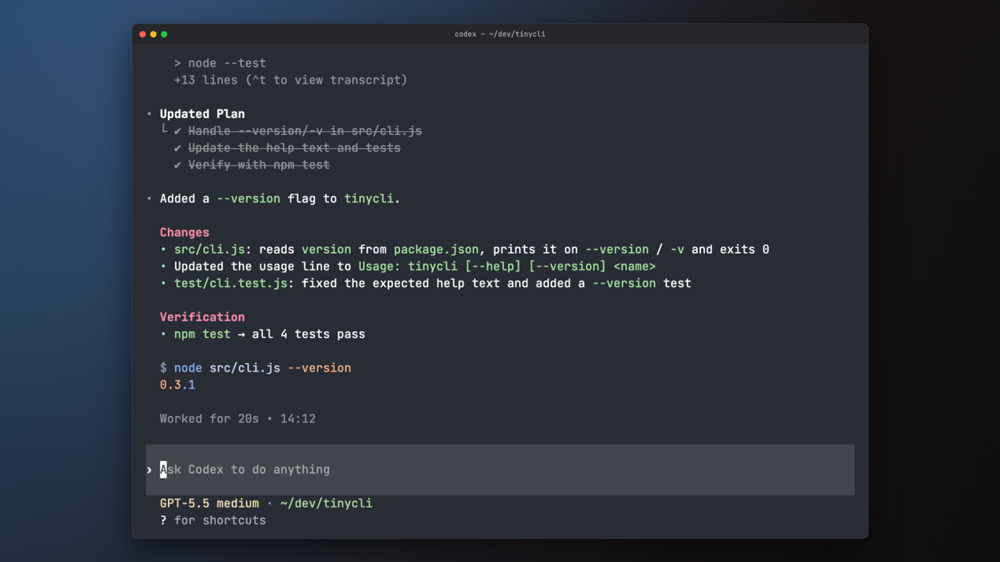
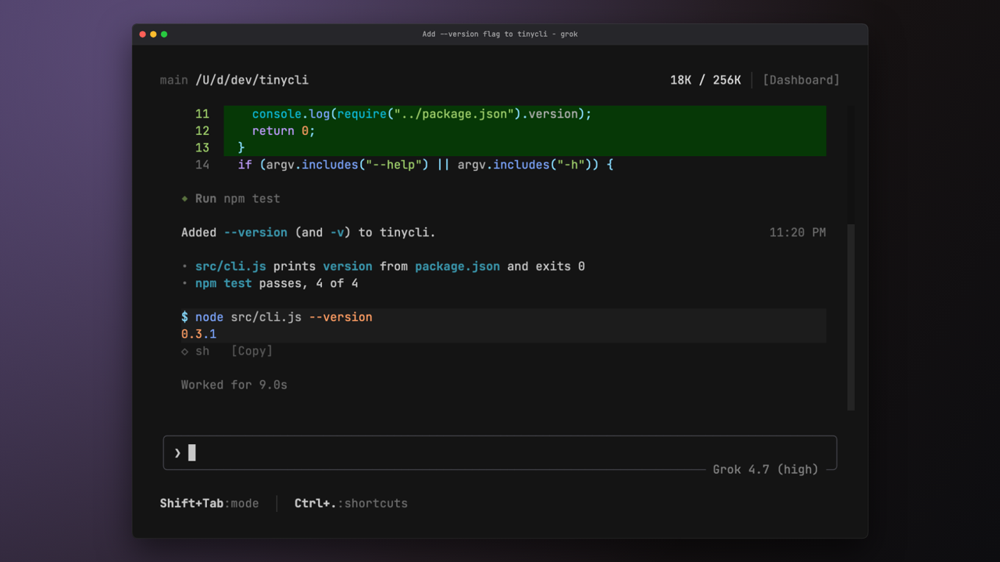

# Dejavu

**Replay any coding-agent session as a video.**

[](docs/promo.mp4)

Dejavu turns a Claude Code, Codex or Grok Build session into an MP4 that looks exactly like the
agent's own terminal. It's like Carbon, but for agent sessions.

It doesn't record your screen. It reads the session log the agent already keeps on disk. Then it
redraws every frame on a cell grid, from the typed prompt to the streamed replies, tool calls,
diffs, todos and spinner.

- **After the fact.** Render a session that ended days ago. You don't have to plan a recording.
- **Your framing.** Choose the window size, playback speed, resolution and which turns to show.
- **Local only.** Logs are read from your disk and never uploaded. No account is needed.

| Claude Code | Codex | Grok Build |
|---|---|---|
|  |  |  |

## Install

You need Node 20+ and [ffmpeg](https://ffmpeg.org) (`brew install ffmpeg` or `apt install ffmpeg`).

```bash
npm install -g agent-dejavu    # installs the `dejavu` command
```

Or run it once without installing: `npx agent-dejavu`.

## Quick start

From inside a project you have used an agent in:

```bash
dejavu list        # sessions recorded for this directory
dejavu             # render the newest one → dejavu-<id>.mp4
```

`dejavu list` prints one line per session, with its id, time, agent and first prompt:

```
7c1e2f4a  10/29/26, 2:20 PM   Claude Code   Add a --version flag to tinycli. It should just print the version
a91d03be  10/28/26, 6:05 PM   Codex         Fix the flaky retry test in src/net.js
```

## Usage

```bash
dejavu 7c1e2f4a                                   # a session by id (a prefix is enough)
dejavu 7c1e2f4a --turns 2-3 --speed 1.5 -o demo.mp4
dejavu 7c1e2f4a -o demo.gif                       # .mp4, .webm or .gif
dejavu 7c1e2f4a --width 1080 --height 1920 --cols 56 --rows 44   # vertical, for social
dejavu path/to/session.jsonl --still 12           # one PNG at 12s
```

A session can be a session id, a `.jsonl` log, a folder of logs or a project directory.

| Option | Default | |
|---|---|---|
| `-o, --out` | `dejavu-<session>.mp4` | Output file: `.mp4`, `.webm` or `.gif` |
| `-s, --speed` | `1` | Playback speed |
| `-t, --turns` | all | Only these prompts: `3`, `2-5`, `4-` |
| `--cols` / `--rows` | `100` / `28` | Terminal size in cells |
| `--width` / `--height` | `1920` / `1080` | Video resolution. Text is drawn at native size. |
| `--fps` | `30` | Frame rate |
| `--still <sec>` | | Save one PNG frame instead of a video |
| `--agent <id>` | auto | Force the agent (`claude-code`, `codex`, `grok`) when detection can't tell |

Pacing is reconstructed rather than real-time, so a 40-minute session doesn't become a 40-minute
video. The spinner still shows each turn's real elapsed time, taken from the log's timestamps.

## Supported agents

| Agent | Session logs | UI modeled on |
|---|---|---|
| Claude Code | `~/.claude/projects/<cwd>/<id>.jsonl` | 2.x |
| Codex | `~/.codex/sessions/YYYY/MM/DD/rollout-*.jsonl` | CLI 0.165 |
| Grok Build | `~/.grok/sessions/<cwd>/<id>/updates.jsonl` | 1.0.70 |

If Codex or Grok keep their data somewhere else, set `CODEX_HOME` or `GROK_HOME`. For Grok, Dejavu
also reads `~/.grok/config.toml` (compact mode, permission mode) and the models cache, so the
replay matches how your own Grok looks.

## How it works

```
session log ─▶ agents/<agent>/parse.ts   normalized events (prompt, reply, thinking, tool + result)
            ─▶ agents/<agent>/scene.ts   timeline: what is on screen at time t
            ─▶ agents/<agent>/ui.ts      the agent's UI as rows of styled cells
               core/highlight.ts         syntax colors for code blocks, diffs and commands
            ─▶ core/draw.ts              cells → pixels (window chrome, smooth scroll)
            ─▶ core/encode.ts            frames → ffmpeg → video
```

Text layout, the timeline, drawing and encoding are shared. Each agent only supplies a parser and
its own UI.

## Contributing

Issues and pull requests are welcome. Rendering bugs are easiest to fix with a session log that
reproduces them. Strip anything private from the log before you attach it.

```bash
git clone https://github.com/ponycompute/dejavu.git && cd dejavu && npm install
npm run dev -- list    # run the CLI from source
npm test
npm run typecheck
npm run sample         # render fixtures/claude-code-sample.jsonl → out/sample.mp4
```

**Adding an agent.**
1. Implement the `Agent` interface in [`src/core/types.ts`](src/core/types.ts): detect a log,
   list sessions, parse, and build a scene.
2. Register it in [`src/agents/index.ts`](src/agents/index.ts).
3. Add a small fixture and tests under `fixtures/` and `test/`.

## License

[Apache-2.0](LICENSE). The Codex and Grok Build screens are recreated from those projects'
open-source TUIs, which are also Apache-2.0. See [NOTICE](NOTICE) for details.

Claude Code, Codex and Grok are trademarks of their respective owners. Dejavu is not affiliated
with or endorsed by Anthropic, OpenAI or xAI.
